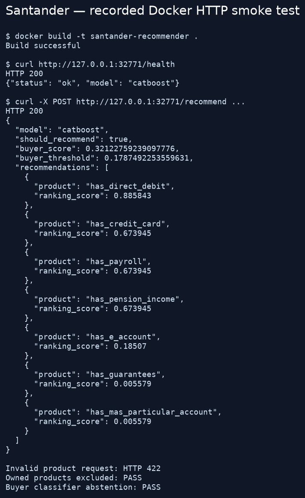

# Local Docker deployment evidence

Tested 2026-11-15T22:20:52.952440+01:00 using image `sha256:379779bf4150988b187cbffc4979f79f0aeb866ad0669c23e6f30b6a599096c2`.

The image was built successfully with `docker build -t santander-recommender .`.
An isolated container was started with a dynamically assigned localhost port:

```sh
docker run --rm -d --name santander-review-3c7da56f -p 127.0.0.1::8000 santander-recommender
docker port santander-review-3c7da56f 8000/tcp
curl http://127.0.0.1:32771/health
curl -X POST http://127.0.0.1:32771/recommend -H 'Content-Type: application/json' --data-binary @examples/request_selected.json
```

Health: **HTTP 200** — `{"status": "ok", "model": "catboost"}`.
Recommendation endpoint: **HTTP 200**.

```json
{
  "model": "catboost",
  "should_recommend": true,
  "buyer_score": 0.32122759239097776,
  "buyer_threshold": 0.1787492253559631,
  "recommendations": [
    {
      "product": "has_direct_debit",
      "ranking_score": 0.885843
    },
    {
      "product": "has_credit_card",
      "ranking_score": 0.673945
    },
    {
      "product": "has_payroll",
      "ranking_score": 0.673945
    },
    {
      "product": "has_pension_income",
      "ranking_score": 0.673945
    },
    {
      "product": "has_e_account",
      "ranking_score": 0.18507
    },
    {
      "product": "has_guarantees",
      "ranking_score": 0.005579
    },
    {
      "product": "has_mas_particular_account",
      "ranking_score": 0.005579
    }
  ]
}
```

The smoke test verified classifier-selected recommendations, classifier abstention with an empty list for `examples/request.json`, exclusion of all already-owned products, and **HTTP 422** for an invalid product name. The test container was stopped after verification; the dynamic port above is a recorded test endpoint, not a persistent deployment.



The image renders captured test output, rather than a browser screenshot. Raw request/response evidence is in [response.json](response.json). Reproduce the service using the fixed-port commands in the [README](../../README.md).
